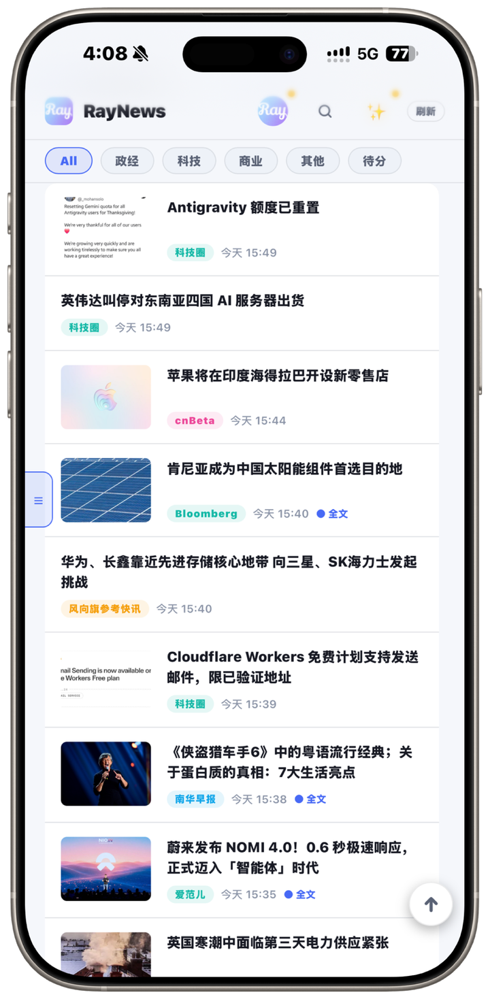
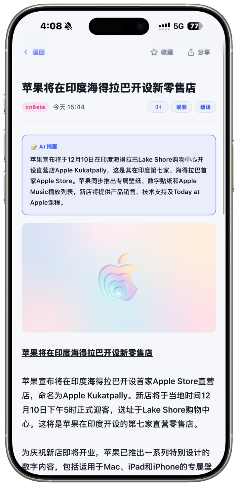
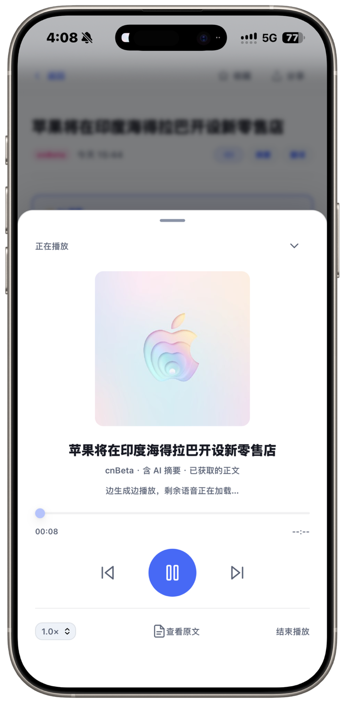
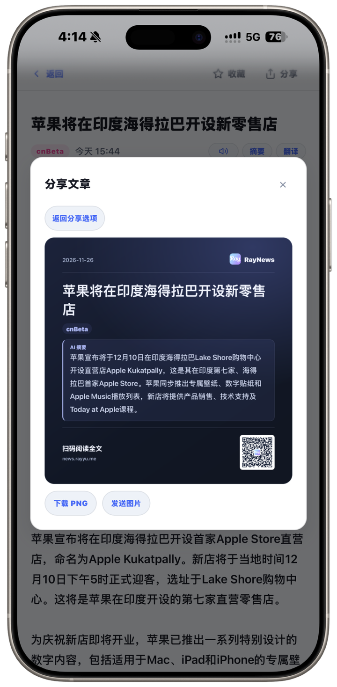

# RayNews 📡 🤖

<p align="center">
  <b>🇨🇳 中文</b> | <a href="README.en.md">🇺🇸 English</a>
</p>

自托管的新闻聚合阅读器：从 Telegram 公开频道抓取新闻，用浏览器或手机 PWA 阅读，并可选接入 AI 摘要、翻译、每日总结和语音朗读。

> **⚠️ 前置条件：RayNews 只读取 Telegram 公开频道，不负责把 RSS 内容推送进频道。**
> 先准备一个公开频道，并用 [RSS-to-Telegram-Bot](https://github.com/Rongronggg9/RSS-to-Telegram-Bot) 或其他机器人、或手工发消息，把你的新闻源转成频道消息，RayNews 再从该频道抓取。

**示例网站：** [https://news.rayyu.me](https://news.rayyu.me)

## 页面预览

<table>
  <tr>
    <td align="center"><br><sub>首页 · 分类与列表</sub></td>
    <td align="center"><br><sub>文章详情 · 摘要与正文</sub></td>
  </tr>
  <tr>
    <td align="center"><br><sub>语音朗读 · 边生成边播放</sub></td>
    <td align="center"><br><sub>分享图片 · 海报生成</sub></td>
  </tr>
</table>

## 功能

### 阅读

- **文章抓取**：每 15 分钟自动抓取新文章，也可随时手动刷新
- **全文提取**：提取 Telegraph 等网页全文；含微信文章链接的消息会尽力抓取全文
- **分类筛选**：按媒体来源和自定义分类筛选文章，来源与分类分开维护
- **搜索翻页**：搜索标题、来源和摘要，支持翻页浏览；断网时标记缓存结果
- **横滑切类**：首页左右横滑切换顶部分类，切换期间保留当前分类直到新内容就绪
- **收藏**：收藏文章并在多设备登录后同步
- **分享**：分享文章链接，或生成带标题、来源、摘要和二维码的分享图片
- **图片缓存**：文章图片经服务端缓存，收藏文章的图片永久保留、不被清理
- **主题与离线**：明暗主题跟随系统，可安装为 PWA，断网可读已缓存内容

### AI 能力

由管理员统一配置服务端 API，按用户逐项授权，用户自行决定是否开启显示。

- **摘要**：为文章生成要点摘要
- **标题简写**：把过长的标题压缩成短标题
- **翻译**：英文标题和正文自动译为中文，原文与译文可分别显示
- **每日总结**：每天定时汇总前一日新闻，网页通知和邮件二选一或同时推送
- **语音朗读**：朗读标题、摘要和正文，支持分段流式播放、倍速、上下篇切换和后台播放

## 快速开始

需要 Docker 与 Docker Compose，以及一个已经推送了新闻的 Telegram 公开频道（见顶部前置条件）。

```bash
git clone https://github.com/rayyume/RayNews-Reader.git
cd RayNews-Reader
cp .env.example .env
```

在 `.env` 中至少填写两项：

```dotenv
TELEGRAM_CHANNEL_URL=https://telegram.me/s/your_public_channel
RAYNEWS_PUBLIC_URL=https://news.example.com
```

然后启动：

```bash
docker compose up -d
```

访问 `http://<服务器地址>:8090`。启动后立即可以打开页面，首次抓取在后台进行，完成前可能暂无文章。

**第一个注册的账号自动成为管理员。** 之后的用户需要邀请码注册，注册后由管理员授权 AI 功能。

## 配置

上面的两项必填，其余按需：

| 变量 | 默认值 | 说明 |
|------|--------|------|
| `TZ` | `Asia/Shanghai` | 容器时区，也是每日总结的计划时区 |
| `RAYNEWS_SECRET` | 自动生成 | 登录令牌签名密钥，未设置时生成后保存在 `/app/data` |
| `DATA_DIR` | `/app/data` | 数据目录 |
| `RESEND_API_KEY` | 空 | 邮件服务，配置后才启用邀请码、注册和每日总结邮件 |
| `RAYNEWS_ADMIN_EMAIL` | 首个管理员邮箱 | 接收邀请码申请、注册通知和清理结果 |
| `RAYNEWS_FROM_EMAIL` | `onboarding@resend.dev` | 发件人地址，正式使用建议换成已验证域名 |
| `IMAGE_CACHE_MAX_MB` | `5120` | 图片缓存容量上限，收藏文章的图片不计入 |
| `TTS_WORKERS` | `2` | 同时生成的语音数量（1–8） |
| `TTS_CACHE_MAX_MB` | `256` | 语音临时文件容量上限（64–2048） |
| `TTS_REQUEST_TIMEOUT_SECONDS` | `300` | 单次语音合成超时 |
| `HTTP_PROXY` / `HTTPS_PROXY` | 空 | 抓取文章和图片时使用的代理 |
| `CUSTOM_HEAD_HTML` / `CUSTOM_FOOTER_HTML` | 空 | 注入页面的自定义 HTML，例如统计脚本 |

AI 接口地址、模型和密钥不在环境变量里，由管理员在页面上配置。**完整变量清单与高级调优项见 [配置说明](docs/configuration.md)。**

## 使用

### 管理员

进入 **管理员设置**，按顺序完成三件事：

1. **订阅源**：查看抓取到的来源，设置分类、合并或删除来源及其历史文章
2. **AI 服务**：填写接口地址、模型和密钥，然后分别开启摘要、标题、翻译、每日总结和语音阅读
3. **用户管理**：给普通用户勾选五项权限，摘要、标题简写、翻译、每日总结、TTS

其他的常用操作：

- **每日总结设置**：在 **AI 服务 → 每日总结** 里改生成时间和推送方式，保存后立即生效，无需重启
- **资源与清理**：在 **系统维护** 查看资源占用、临时音频用量，按日期清理历史文章
- **邀请注册**：生成邀请码发给新用户；第一个注册账号自动成为管理员

### 普通用户

- **开启功能**：在 **用户设置 → AI 功能** 里逐项开启已获授权的功能
- **语音朗读**：文章详情页点击摘要按钮前的喇叭开始朗读；右下角出现旋转碟片，点击展开播放器，可暂停、拖动进度、调速、切上下篇；返回列表或浏览其他文章不会中断播放
- **每日总结**：站内通知在 **头像菜单 → 我的通知**，邮件订阅在 **用户设置 → 通知** 里单独开启
- **主题与显示**：在 **用户设置 → 主题** 切换明暗或跟随系统

## 权限说明

角色只有普通用户和管理员两种。

| 能力 | 未登录 | 普通用户 | 管理员 |
|------|--------|----------|--------|
| 浏览文章 | 仅首页前 3 篇 | ✓ | ✓ |
| 搜索、翻页、收藏、手动刷新 | — | ✓ | ✓ |
| 查看 AI 摘要、翻译、每日总结、朗读 | — | 需逐项授权并开启 | ✓ |
| 主题、通知与 AI 显示设置 | — | ✓ | ✓ |
| 管理订阅源、AI 服务、用户与历史清理 | — | — | ✓ |

## 镜像与更新

`docker-compose.yml` 默认用 `build: .` 构建当前代码。想直接用预构建镜像，把 `build` 注释掉，改用：

```yaml
image: ghcr.io/rayyume/raynews:latest   # 稳定版
image: ghcr.io/rayyume/raynews:dev      # 开发测试版
```

更新：

```bash
docker compose pull && docker compose up -d
```

## 数据与备份

```yaml
volumes:
  - ./data:/app/data
```

`/app/data` 里是文章数据库、用户与 AI 设置、登录密钥、头像、图片缓存和抓取状态。**升级或重建容器必须保留整个目录**，备份也是备份这一个目录。语音临时文件存放在容器内的临时路径，不进入 `/app/data`，不需要备份。

## 从 v5 升级

升级前先备份整个 `/app/data`。升级后：

- 已有用户会一次性获得五项 AI 权限，之后新建的普通用户默认无权限，需管理员手动授权
- 原有的翻译、摘要和标题显示偏好保留，旧标题查看开关会拆成标题翻译和标题简写两个开关
- 老用户的每日总结保持开启并保留订阅选择，语音朗读默认关闭
- v5 已生成的 AI 摘要、译文和标题继续可用，受新的权限和开关控制

细节见 [架构与迁移说明](docs/architecture.md)。

## 路线图

### 短期

- [x] 订阅源分类
- [x] 微信公众号文章尽力抓取
- [x] 收藏夹
- [x] 英文标题与正文自动翻译
- [x] 自定义 AI 接口
- [x] 每日总结与语音朗读
- [ ] 用户自定义可见订阅源
- [ ] 关注订阅源的新文章通知

### 长期

- [ ] 集成 [RSStT](https://github.com/Rongronggg9/RSS-to-Telegram-Bot)，无需单独部署
- [ ] 关键词过滤
- [ ] 新闻 Podcast
- [ ] 原生 iOS 客户端

## License

MIT
